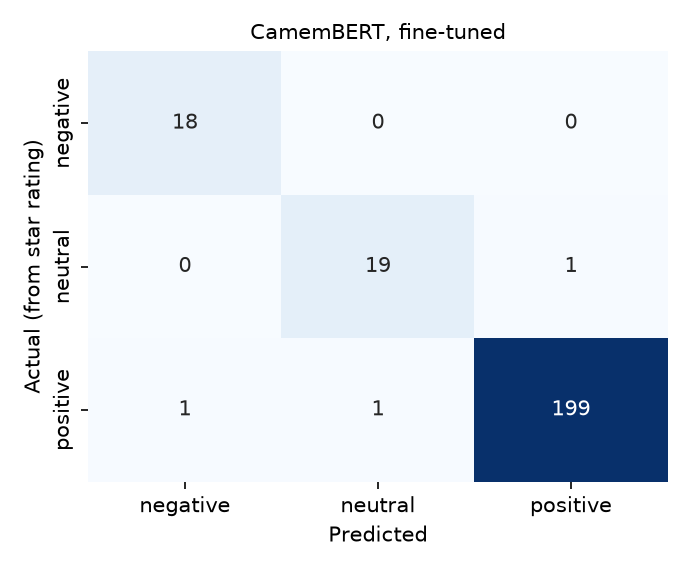

# Customers-Review-Analysis

A comprehensive pipeline for collecting, cleaning, labeling, and analyzing customer reviews using machine learning techniques.

## Overview

This project focuses on the end-to-end process of customer review analysis, encompassing:
* **Data Collection**: Scraping customer reviews from online sources.
* **Data Cleaning**: Preprocessing and cleaning the collected data for analysis.
* **Data Labeling**: Assigning sentiment labels to reviews for supervised learning.
* **Modeling**: Applying machine learning models, including Logistic Regression and BERT, for sentiment classification.
* **Visualization**: Generating plots to understand data distributions and model performance.

## Benchmark results

[`experiments/run_benchmark.py`](experiments/run_benchmark.py) re-evaluates the models in a reproducible way:
- duplicates are removed (231 of 1,425 rows) **before** the train/test split;
- labels come from the **star rating** (1–2 negative, 3 neutral, 4–5 positive);
- the split is stratified 80/20, and the classic models also get 5-fold cross-validation;
- because the classes are imbalanced, the main metric is **macro-F1**.

| Model | Accuracy | Macro-F1 | 5-fold macro-F1 |
|-------|---------:|---------:|----------------:|
| Majority class (baseline) | 0.841 | 0.305 | 0.304 |
| TF-IDF + Naive Bayes | 0.992 | 0.982 | 0.998 ± 0.004 |
| TF-IDF + Logistic Regression | 0.992 | 0.982 | 0.998 ± 0.004 |
| Multilingual BERT, zero-shot ([nlptown](https://huggingface.co/nlptown/bert-base-multilingual-uncased-sentiment)) | 0.833 | 0.645 | n/a |
| CamemBERT, fine-tuned (4 epochs) | 0.987 | 0.972 | n/a |

Test set: 239 reviews. Full numbers are in [`results/metrics.json`](results/metrics.json).



### Why these scores are too optimistic (and what was learned)
Checking the data behind the near-perfect scores found two issues:

1. **The labels were generated by another model.** `labeling_dataset.py` assigned sentiment with an Arabic sentiment model applied to French text. Those labels disagree with the star ratings on 17.5% of reviews: for example, **20.7% of 4–5 star reviews were labelled negative**. The benchmark therefore uses the ratings as labels.
2. **The language of a review gives its class away.** The scraped reviews are French and almost all 4–5 stars (1,003 of 1,004). All 1–3 star reviews were written separately in **Tunisian Arabizi**, e.g. "3ayeb", "ma zedni chy" ([`results/shortcut_check.json`](results/shortcut_check.json)). As a result, a model can score highly just by recognising the language, without understanding sentiment. A crude rule that only detects Arabizi spelling already reaches 88% accuracy on "positive or not".

The zero-shot multilingual model was never trained on this data, so it can't use that shortcut. It is the most honest estimate of real-world performance here (macro-F1 0.645). The fix is to collect negative and neutral reviews from the same source and in the same language as the positive ones.

Reproduce:
```bash
pip install -r requirements-experiments.txt
python experiments/run_benchmark.py          # add --skip-bert for the fast classic models only
python experiments/shortcut_check.py
```

## Repository Structure

* `data-scraping.py`: Script for scraping raw customer reviews.
* `data-preparation.py`: Script for cleaning and preprocessing the scraped data.
* `data-preparation-with-plots.py`: Extends data preparation with visualizations.
* `labeling_dataset.py`: Script for labeling the dataset with sentiment categories.
* `shuffle.py`: Utility script to shuffle the dataset.
* `NB1.ipynb`: Jupyter notebook for exploratory data analysis.
* `logistic_regression.ipynb`: Notebook implementing Logistic Regression for sentiment analysis.
* `bert.ipynb`: Notebook implementing BERT model for sentiment classification.
* `reg_log.ipynb` / `reglog.ipynb`: Additional notebooks for regression analysis.
* `reviews.csv` / `reviews.xlsx`: Raw scraped reviews.
* `cleaned_reviews.csv` / `cleaned_reviews.xlsx`: Cleaned and preprocessed reviews.
* `classified_reviews.csv` / `classified_reviews.xlsx`: Labeled reviews with sentiment categories.
* `final_dataset.csv` / `final_dataset1.csv`: Final datasets used for modeling.

## Getting Started

### Prerequisites

* Python 3.x
* Required Python libraries:
   * `pandas`
   * `numpy`
   * `scikit-learn`
   * `matplotlib`
   * `seaborn`
   * `transformers`
   * `tensorflow` or `pytorch`
   * `beautifulsoup4`
   * `requests`

### Installation

1. Clone the repository:

```bash
git clone https://github.com/ArijAguel/Customers-Review-Analysis.git
cd Customers-Review-Analysis
```

2. Install the required libraries:

```bash
pip install -r requirements.txt
```
Note: Create a requirements.txt file with the necessary libraries.

## Usage

1. Data Scraping:
Run the data-scraping.py script to collect customer reviews:

```bash
python data-scraping.py
```

2. Data Preparation:
Clean and preprocess the scraped data:

```bash
python data-preparation.py
```

For additional visualizations:
```bash
python data-preparation-with-plots.py
```

3. Data Labeling:
Label the dataset with sentiment categories:

```bash
python labeling_dataset.py
```

4. Modeling:

* *Logistic Regression*:
Open and run the logistic_regression.ipynb notebook.
* *BERT Model*:
Open and run the bert.ipynb notebook.


## Results

* *Logistic Regression*: Provides a baseline for sentiment classification with interpretable coefficients.
* *BERT Model*: Leverages transformer-based architecture for improved accuracy in sentiment analysis.

Note: Detailed results, including accuracy scores and confusion matrices, are available within the respective notebooks.
